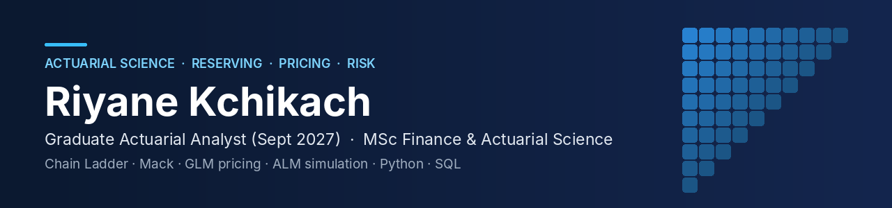

  
  
  

Final-year **MSc Finance & Actuarial Science** student (University Hassan I, GPA 3.73/4, graduating June 2027), looking for a **Graduate Actuarial Analyst** role from **September 2027** in the UK, Ireland, Europe or Canada. Committed to the actuarial exams.

I build actuarial and risk tools: claims reserving and reserve uncertainty, asset-liability simulation, pricing GLMs and credit risk models.

## Experience

**Actuarial Intern, Non-Life Reserving** · RMA (insurer), Casablanca · Jun–Jul 2026
- Rebuilt and validated a 32-accident-year claims triangle (1993–2024) from heterogeneous sources.
- Cross-checked claims provisions with Chain Ladder, London Chain and Taylor Separation.
- Isolated calendar-year claims inflation (about 1.5% a year) with a log-linear regression.

**Financial Analyst Intern** · KeyWise, Rabat · Jul–Sep 2024
- Cut reporting time by 30% for 15+ stakeholders with automated Power BI dashboards and ETL pipelines.

## Featured project: Non-Life Reserving Dashboard

Chain Ladder, London Chain and Taylor separation on a simulated 32-year triangle, with Mack standard error and 99.5% VaR. The Mack implementation is checked against the Taylor–Ashe benchmark. **[Try it live](https://kchikachriyane.github.io/actuarial-projects/Non-Life-Reserving-Dashboard/)** · [code](https://github.com/kchikachriyane/actuarial-projects/tree/main/Non-Life-Reserving-Dashboard)

## Projects

| Project | Highlights | Stack |
| --- | --- | --- |
| [ALM Stochastic Simulator](https://github.com/kchikachriyane/actuarial-projects/tree/main/ALM-Stochastic-Simulator) | Vasicek rates + correlated GBM equities, 5,000 scenarios over 30 years, funding ratio, 99.5% VaR, +200 bp stress | Python, NumPy |
| [Stochastic Reserving Dashboard](https://github.com/kchikachriyane/actuarial-projects/tree/main/Stochastic-Reserving-Dashboard) | Chain Ladder vs Bornhuetter-Ferguson, Mack variances, log-normal reserve distribution | JavaScript |
| [Insurance Power BI dashboards](https://github.com/kchikachriyane/actuarial-projects) | Motor premium drivers and health insurance charges | Power BI, DAX |
| Credit default prediction | Neural network vs gradient boosting (ROC-AUC 0.775), threshold analysis, Streamlit scoring app | Python, TensorFlow |
| Motor insurance pricing (freMTPL2) | Exposure-smoothed frequency, Gamma severity GLM, area × fuel interactions | SPSS |

The last two are written up on my [LinkedIn](https://www.linkedin.com/in/riyanekchikach).

## Toolkit

- **Actuarial:** claims reserving (Chain Ladder, London Chain, Taylor Separation, Bornhuetter-Ferguson, Mack), IBNR, loss distributions, GLM pricing, ALM, Solvency II concepts
- **Programming & data:** Python (pandas, NumPy, scikit-learn, TensorFlow), SQL, JavaScript, Excel, Power BI, EViews, SPSS
- **Languages:** English (C1), French (C1), Arabic (native)
